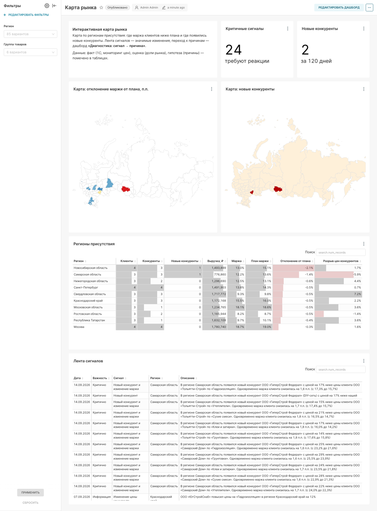
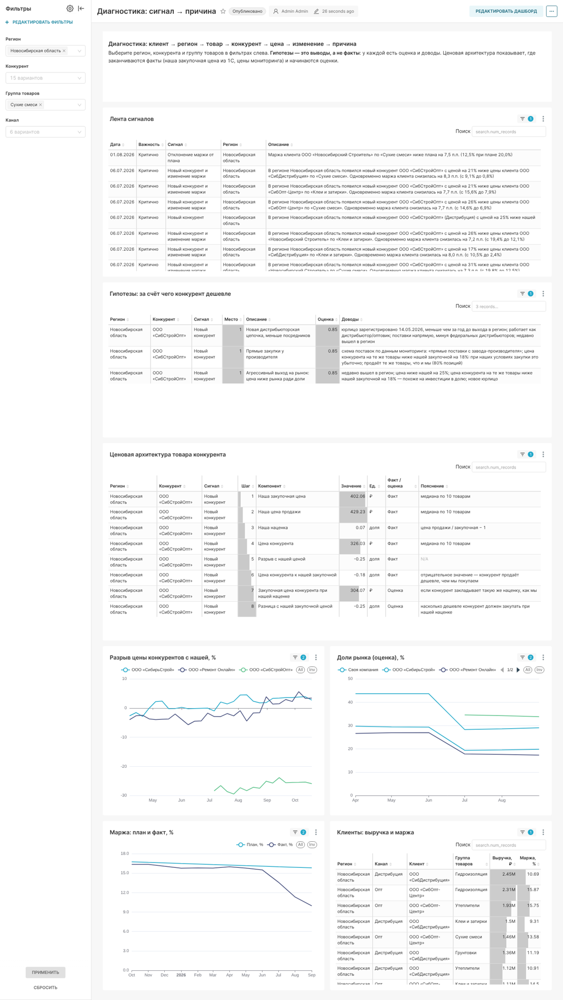

# Дашборды Superset

Superset открывается по адресу http://localhost:8088 (по умолчанию `admin` / `admin`). Два дашборда создаются автоматически при `docker compose up`.

## «Карта рынка» (`/superset/dashboard/market-map/`)



- **Карты России:**
  - отклонение маржи клиентов от плана — красные регионы ниже плана;
  - новые конкуренты.
- **Показатели:** критичные сигналы, новые конкуренты за 120 дней.
- **Таблица регионов присутствия:** клиенты, конкуренты, выручка, маржа против плана, разрыв цен с конкурентами.
- **Лента сигналов** о рыночных изменениях.
- **Фильтры:** регион, группа товаров.

## «Диагностика: сигнал → причина» (`/superset/dashboard/diagnostics/`)



Путь из ТЗ: клиент → регион → товар → конкурент → цена → изменение → причина.
- **Лента сигналов** по выбранному региону.
- **Гипотезы** «за счёт чего конкурент дешевле»: топ-3 на сигнал с оценкой и доводами.
- **Ценовая архитектура:** у каждой строки отмечено, факт это или оценка.
- **Графики:** разрыв цен конкурентов с нашей, доли рынка (оценка), маржа план/факт.
- **Таблица клиентов:** выручка и маржа.
- **Фильтры:** регион, конкурент, группа товаров, канал.

**Фильтры по умолчанию** открывают сценарий из ТЗ: регион «Новосибирская область», группа «Сухие смеси». Группа по умолчанию действует только на графики: у сигнала «новый конкурент» группы нет, и фильтр скрыл бы его из ленты.

## Как устроено и как менять

Дашборды описаны кодом в `superset/build_dashboards.py`: датасеты, графики, раскладка, фильтры. Скрипт работает через REST API Superset и выгружает результат штатным экспортом в `superset/dashboards/`. Эту выгрузку импортирует `superset/bootstrap.sh` при каждом старте стенда. Пароль подключения в выгрузке замаскирован, его подставляет `bootstrap.sh` из переменных окружения.

Изменить дашборд:

```bash
docker compose up -d --wait                      # стенд с данными
pip install httpx
python superset/build_dashboards.py --export     # пересобрать и выгрузить
docker compose build superset superset-init      # выгрузка попадает в образ
```

Правки, сделанные мышкой в интерфейсе Superset, при следующем старте перезапишутся выгрузкой из репозитория. Чтобы их сохранить, перенесите изменения в `build_dashboards.py` и выгрузите заново.

## Особенности Superset 4.1, учтённые в сборке

- **Карта России (Country Map)** раскрашивает регионы по значению только если у дашборда не задана цветовая схема. Со схемой регионы окрашиваются категориальными цветами.
- **Коды регионов карты** отличаются от ISO у Москвы, Московской области, Крыма и Севастополя. В витринах для карты используется поле `map_code` ([marts.md](marts.md)).
- **Ячейки раскладки** должны ссылаться на графики по `uuid`. Иначе после импорта на другом стенде, где у графиков другие id, раскладка разваливается.
