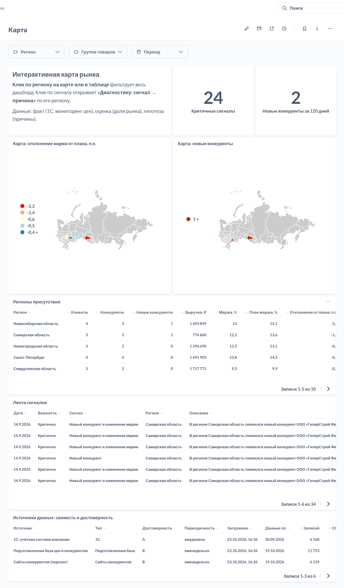
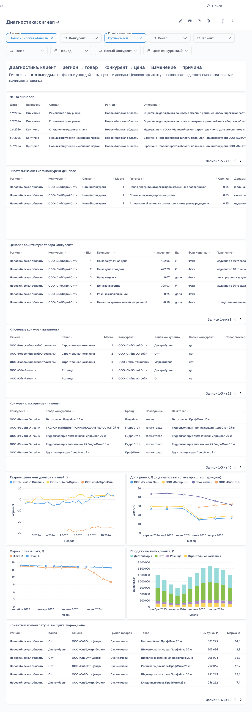

# Дашборды Metabase (вторая BI)

Metabase работает поверх тех же витрин `marts`, что и Superset. Он подтверждает главный принцип архитектуры: все расчёты живут в хранилище, поэтому BI можно заменить или добавить без переделки логики.

Адрес — http://localhost:3000 (по умолчанию `admin@example.com` / `market-map-2026`). Коллекция **Market Map**, два дашборда, как в Superset. Оба создаются автоматически при `docker compose up`.

## «Карта рынка»

- **Карты России:** отклонение маржи от плана (красные — ниже плана) и новые конкуренты.
- **Клик по региону на карте** фильтрует весь дашборд. В Superset карта так не умеет, там регион выбирается кликом в таблице. Клик по строке таблицы регионов тоже фильтрует.
- **Клик по строке ленты сигналов** открывает «Диагностику» с регионом этого сигнала: переход от сводки к причинам.
- Показатели, таблица регионов, лента сигналов, источники данных.
- **Фильтры:** регион, группа товаров, период.

## «Диагностика: сигнал → причина»

Состав такой же, как в Superset:
- сигналы;
- гипотезы;
- ценовая архитектура (факт/оценка);
- ключевые конкуренты клиента;
- ассортимент конкурента;
- графики разрыва цен, долей рынка, маржи план/факт и продаж по типу клиента;
- клиенты и номенклатура.

Фильтры: регион, конкурент, группа товаров, канал, клиент, товар, период, новый конкурент, цена конкурента (диапазон). По умолчанию открывается сценарий из ТЗ: Новосибирская область, «Сухие смеси».

## Как устроено

- **Дашборды как код** — `metabase/provision.py`. Это SQL-вопросы к витринам, раскладка, фильтры и переходы по клику. Скрипт работает через REST API Metabase и идемпотентен: при каждом старте стенда обновляет найденное по названию, лишнее в коллекции переносит в архив.
- **Сервис `metabase-provision`** запускает скрипт после старта Metabase. Он ждёт, пока планировщик создаст витрины и загрузит данные. Готовым (healthy) сервис становится, когда дашборды собраны, поэтому `docker compose up --wait` дожидается и их.
- **Карта регионов** — `metabase/geo/russia-regions.json`. Это GeoJSON карты России из Superset (Apache 2.0) с ключом по полному названию региона, как в витринах. Metabase загружает карты только по HTTP, поэтому файл раздаёт тот же сервис `metabase-provision`.
- **Подключение к хранилищу** идёт под пользователем `bi_reader` (только чтение `marts`).
- **Фильтры** — поля-фильтры Metabase (`{{region}}` в SQL). Без значения подставляется `1 = 1`, со значением — условие по колонке витрины. Поэтому одна карточка работает и с фильтром, и без.
- **Метаданные Metabase** (пользователи, вопросы) хранятся во встроенной базе H2 в томе `metabase-data`. Это нормально для демо. Для эксплуатации стоит перевести Metabase на PostgreSQL (`MB_DB_TYPE=postgres`).

Изменить дашборд: поправьте `metabase/provision.py` и выполните `docker compose restart metabase-provision` (или `python metabase/provision.py` против работающего Metabase). Правки, сделанные мышкой в коллекции Market Map, перезапишутся при следующем старте.

## Superset и Metabase

| | Superset | Metabase |
|---|---|---|
| Клик по региону на карте | нет, только в таблице | да |
| Переход «сигнал → диагностика» по клику | нет | да |
| Как код | экспорт/импорт YAML | скрипт REST API |
| Порог входа для пользователя | выше, богаче графики | ниже, проще конструктор вопросов |
